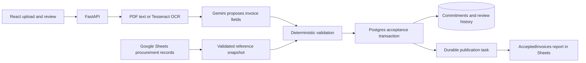

# Invoice Exception Review

Upload a supplier invoice and see whether it can be accepted against a purchase
order. The app shows the source evidence, explains the decision and tracks the
remaining PO balance. It sends ambiguous or unreadable invoices to an admin for
review and blocks duplicate commitments.

[Open the hosted app](https://asa-invoice-review.onrender.com/) ·
[Download the reviewer invoices](tests/fixtures/demo_packs/B/invoice-demo-B.zip) ·
[Follow the walkthrough](docs/DEMO.md) ·
[See verification evidence](docs/VERIFICATION.md)

## Try the demo

**[Open the live app](https://asa-invoice-review.onrender.com/)** and sign in with **Recruiter Admin** to upload an invoice, review exceptions, and view the dashboard in one session.

| Demo account | Email | Password |
| --- | --- | --- |
| Recruiter Admin | `recruiter.admin@invoice-review.example` | Reviewer access document |
| Recruiter User | `recruiter.user@invoice-review.example` | Reviewer access document |

Use the password in the private **Reviewer Access** document attached to the submission. **Recruiter User** is optional if you want to try the uploader view. This shared demo uses synthetic records. Start with **Pack B** for a fresh upload.

| Order | Sample | What to look for |
| --- | --- | --- |
| 1 | [01 · Clean invoice](tests/fixtures/demo_packs/B/01_clean_invoice.pdf) | ₹10,000 accepted on its own PO. Inspect the payable quote, nine passing checks and the spreadsheet publication status. |
| 2 | [02 · Duplicate](tests/fixtures/demo_packs/B/02_duplicate_invoice.pdf) | The same invoice is blocked. Its original acceptance stays the only commitment. |
| 3 | [03 · Partial invoice](tests/fixtures/demo_packs/B/03_partial_6000.pdf) | ₹6,000 accepted against a separate ₹10,000 PO, leaving ₹4,000. |
| 4 | [04 · Over the remaining balance](tests/fixtures/demo_packs/B/04_partial_over_4500.pdf) | ₹4,500 goes to review. The remaining ₹4,000 stays available. |
| 5 | [06 · Ambiguous PO](tests/fixtures/demo_packs/B/06_ambiguous_po.pdf) | Two orders match a ₹5,000 invoice with no printed PO number. Resolve the match and accept separately as admin. |
| 6 | [07 · Unreadable payable](tests/fixtures/demo_packs/B/07_blurred_total.pdf) | The amount stays unknown. The admin can record a request for a clearer original. |
| Optional | [05 · Exact remainder](tests/fixtures/demo_packs/B/05_partial_remainder_4000.pdf) | After the over-balance example, accept the exact ₹4,000 remainder and show a zero balance. |

Each acceptance uses part of the shared demo ledger. Before a fresh take, check
the sample invoice numbers in **Invoices** and the balances in **Dashboard**. The
[walkthrough](docs/DEMO.md) gives the exact order, buttons and expected amounts.

## What reviewers can inspect

- **Invoice result.** See the decision, PO commitment and spreadsheet report
  status separately. Open a source quote and the recorded processing stages.
- **Validation.** The nine checks cover required fields, vendor, PO, source
  evidence, duplicates, currency, arithmetic, line allocation and remaining
  value and quantity.
- **Admin review.** Select among exact PO matches or correct an extraction using
  the original. The app saves a revision and reruns the checks. Acceptance has
  its own action and reason. [Review permissions](docs/ADMIN-REVIEW.md)
- **Dashboard.** Inspect invoice outcomes, the share accepted automatically,
  processing times and the balances on individual purchase orders.
  [Metric definitions](docs/METRICS.md)

## Architecture



Supabase provides sign-in, Postgres and private storage for invoice originals.
FastAPI serves the React app and runs the processing and publication workers.
Gemini receives page text and returns candidate fields with source quotes. The
backend makes the eligibility decision. [AI use](docs/AI-USE.md)

The acceptance transaction locks the PO and checks the current reference,
duplicate identity, and remaining amount and quantity before it commits.
Postgres is the ledger. A Google service account reads the procurement tabs and
publishes accepted invoices to `AcceptedInvoices`. The report carries the same
acceptance ID as the invoice record, and its retry can run without accepting the
invoice again. [Design decisions](docs/DESIGN-DECISIONS.md)

## Run locally

Install Python 3.12+, Node.js 22.12+, [uv](https://docs.astral.sh/uv/) and English
Tesseract. Set up your own Supabase project and Google Sheet using the
[deployment guide](docs/DEPLOYMENT.md). The hosted demo accounts belong to the
hosted workspace. For your own workspace, create Auth users and assign their
roles using the [profile provisioning template](migrations/provision-demo-profiles.sql).

```sh
uv sync --frozen
npm --prefix web ci
npm --prefix web run build
```

Create your local `.env` from [the example](.env.example) and set
`APP_ORIGIN=http://127.0.0.1:8000` and `COOKIE_SECURE=false` for loopback HTTP.
On a fresh database, apply `migrations/schema.sql` and then
`migrations/step3.sql`. Populate the Sheet from [the reference CSVs](tests/reference_data/)
and provision the private storage bucket described in the deployment guide.

```sh
.venv/bin/python -m app.cli doctor --live
.venv/bin/python -m app.cli import-sheet
.venv/bin/uvicorn app.main:app --host 127.0.0.1 --port 8000
```

The [operations guide](docs/OPERATIONS.md) covers readiness, provider errors,
reference sync and publication retry.

## Verify the implementation

```sh
.venv/bin/python -m pytest -q
npm ci
npm run test:native-api
npm --prefix web test
npm --prefix web run build
```

The native runner creates an isolated local Postgres 16 database for tests of
locking, rollback and concurrent acceptance. External providers are simulated
there. The [hosted verification](docs/VERIFICATION.md) separately records live
authentication, extraction, acceptance and matching Sheet writeback.
[Varied layout fixtures](tests/fixtures/layouts/README.md) cover additional
document layouts, scans and uncertain amounts.

## Scope

The app supports English OCR for PDF, JPEG and PNG files up to 5 MiB and three
pages. It verifies invoices against procurement records and records
commitments. Payment, supplier authentication, receipt matching and ERP
integration are outside this workflow. The hosted demo has one workspace,
seven-day retention for originals and free-tier service and model limits.
[Assumptions](docs/ASSUMPTIONS.md) · [Company rollout considerations](docs/PRODUCTION-READINESS.md)
