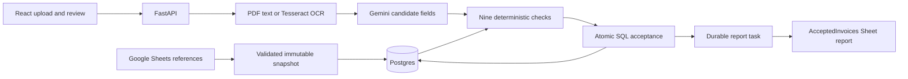

# ASA Invoice Review

Review invoice PDFs against procurement records maintained in Google Sheets.
The app extracts fields with page/quote evidence, runs nine deterministic checks,
and records eligible acceptances transactionally in Postgres. It does not execute
payments.

[Open the application](https://asa-invoice-review.onrender.com) ·
[Deployment](docs/DEPLOYMENT.md) · [Operations](docs/OPERATIONS.md)

## Workspace access

Sign in with an account provisioned by your workspace administrator. The opening
page is **Upload invoice**, followed by **Dashboard** and **Invoices**. Normal users
see their own submissions; administrators review workspace records and resolve
eligible exceptions with a reason and source evidence.

Upload the original PDF, JPEG or PNG. The interface shows reading/verification
progress, original-source evidence, each check and the resulting decision.
Accepted amounts and remaining PO balances are visible on the dashboard;
spreadsheet publication has its own status and safe retry.

Synthetic fixtures and the evaluator walkthrough live in the source repository
under `tests/fixtures/` and `docs/DEMO.md`. They are development resources, excluded
from the server image. The application has no sample catalog or download API.

## What it checks

| Check | Responsibility |
| --- | --- |
| Required information | Critical source fields and supported dates/amounts |
| Vendor | Exact approved legal name or configured alias |
| Purchase order | Explicit matching PO or exact inferred candidates |
| Source evidence | Quoted page text, printed payable amount, OCR uncertainty |
| Duplicate | File hash and vendor/invoice identity |
| Currency | Invoice, PO and configured currency rules agree |
| Arithmetic | Subtotal, tax, total and evidenced rounding reconcile |
| Line allocation | Source descriptions, units, quantities and prices match |
| PO balance | Cumulative value and quantity stay within authorization |

The four primary scenarios are duplicates, partial invoicing/overbilling,
ambiguous PO matching and unreadable critical fields. Supporting tests cover tax,
rounding, missing data, vendor aliases, concurrency and failure recovery.

## Architecture



Postgres owns acceptances, duplicate identities and commitments. Google Sheets is
reference data in and a report out; manual report edits cannot change balances.
Acceptance locks the PO and rechecks source/reference freshness, duplicates and
cumulative commitments. Publication uses a permanent acceptance ID, reserved row,
read-back verification and safe retry. Decision and publication statuses differ.

Supabase provides Auth, Postgres and private original storage. FastAPI serves the
React build and durable processing/publication workers in one Docker service.
The model receives page text only and proposes fields; it cannot approve invoices.
Admin corrections preserve prior revisions, require a reason/evidence, rerun the
checks and require a separate explicit acceptance. Failed checks cannot be bypassed.

## Run locally

Requires Python 3.12+, Node.js 22.12+ and English Tesseract on PATH.

```sh
uv sync --frozen
cd web
npm ci
npm run build
cd ..
```

Create `.env` from `.env.example` without overwriting private configuration. Supply
project-specific Supabase, database, Sheets and Gemini settings. For local HTTP,
use `APP_ORIGIN=http://127.0.0.1:8000` and `COOKIE_SECURE=false`.

For a new database, apply `migrations/schema.sql` then `migrations/step3.sql` as the
migration owner. Provision Auth users and role profiles using the documented SQL
template. Import `tests/reference_data/` into the corresponding Sheet tabs; the
`AcceptedInvoices` tab is a report, never an approval/balance input. Use a private
`invoice-originals` bucket with a 5,242,880-byte limit and PDF/JPEG/PNG allowlist.

```sh
.venv/bin/python -m app.cli doctor --live
.venv/bin/python -m app.cli import-sheet
.venv/bin/uvicorn app.main:app --host 127.0.0.1 --port 8000
```

Sign in with an Auth user's credentials, not the database password. The backend
sets a restricted database role and refuses unsafe direct status-update grants.
HTTP-only local cookies are not appropriate for remote deployment; remote origins
require HTTPS and Secure cookies.

## Prepare another demo pack

```sh
.venv/bin/python tools/generate_fixtures.py --pack D
.venv/bin/python scripts/prepare_demo.py --packs D
.venv/bin/python scripts/prepare_demo.py --packs D --apply
```

The first preparation command is a read-only plan. Applying appends matching PO
and line rows, preserves existing references, verifies read-back and activates the
normal validated import. Conflicting existing codes are rejected. Pack files are
written to `tests/fixtures/demo_packs/` for offline testing and walkthroughs; they
are not shipped by the web service. Packs B and C are included in the source.
Never delete acceptances or rewrite report rows to rehearse.

## Verify

```sh
.venv/bin/python -m pytest -q
npm ci
npm run test:native-api
cd web
npm test
npm run build
```

The native runner creates/destroys an isolated local Postgres 16 cluster and does
not use cloud data. It tests real locks, transactions and fixture PDF/OCR work;
external providers are simulated. Separate live verification covers actual hosted
password logins, extraction, private previews and Sheets publication.

Python's canonical dependency lock is `uv.lock`. Docker installs its generated,
hash-pinned runtime export, `requirements.txt`. Regenerate that export after a
runtime dependency change:

```sh
uv export --frozen --no-dev --no-emit-project --format requirements-txt --output-file requirements.txt
```

## Failure handling and limits

- One visible retry is allowed for transient Gemini 429/503/timeouts. SDK retries
  are disabled, so attempts do not multiply. No retry is made for invalid candidate
  JSON, configuration/auth errors or empty model output. A second transient failure
  leaves the invoice unaccepted with a clear reason.
- Extraction reuse is scoped to one uploader, exact file bytes/MIME/size and
  matching model, prompt, reader and pipeline versions. Only original provider
  evidence from the last seven days is eligible. Copied or admin-corrected
  revisions cannot seed or extend the cache. All nine checks and atomic acceptance
  use current references/commitments. Sample expectations never enter model input;
  fresh documents need live extraction capacity.
- English OCR; PDF/JPEG/PNG; 5 MiB; at most three pages. No currency conversion,
  payment, email intake/delivery, output-invoice generation or ERP integration.
- Unreadable totals remain unknown; subtotal, tax or PO balance cannot substitute
  for printed payable evidence. A clearer-source request is an in-app record.
- Originals expire after seven days. Extracted evidence, hashes and ledger/audit
  records remain. Expired sources cannot be approved through review.
- References must be current. Invalid imports preserve the last valid version;
  stale imports pause eligibility. An admin can sync references from the dashboard.
- Durable jobs survive restarts. Expired leases can take five minutes to recover.
  Workers pause while a sleeping host is inactive. There is no always-on guarantee.
- Do not sort/delete assigned report rows or overwrite another acceptance's cells.
  Conflicts require reconciliation; publication retries do not accept again.
- The deployment has one procurement workspace and currently contains synthetic
  evaluation records. Provisioned evaluator credentials are private. Free-tier
  quotas and host wake-up delays remain deployment limits; see the operations guide
  before connecting a live business workflow.

## Deployment and release

See [deployment instructions](docs/DEPLOYMENT.md). The Dockerfile builds React,
installs Tesseract and serves UI/API/workers together. Configure server secrets in
Render and the Google JSON as `/etc/secrets/Sheet_Service.json`; never in GitHub,
client code or `VITE_` variables.

```sh
.venv/bin/python scripts/check_deployment.py https://asa-invoice-review.onrender.com --output data/hosted-smoke.json
.venv/bin/python scripts/release.py --output ../outputs/invoice-review-release.zip
```

The source release includes a SHA-256 manifest and excludes real credentials,
runtime data, dependencies and demo login passwords. The deployment probe makes
no ledger writes; it is not a substitute for a fresh extraction test.

## Startup and repeated processing

The HTTP listener, UI and liveness endpoint start without waiting for database or
Sheets network calls. Startup verifies restricted DB permissions before starting
workers; an unavailable DB is retried in the background. Readiness returns 503
with `Retry-After` until initialization finishes. If the Sheet import fails, the
last valid snapshot is preserved; normal freshness checks still govern decisions.
Admin diagnostics distinguish configured keys, actual worker state and startup
status. `/health/live` exposes version/uptime without dependency calls.

An identical, previously reviewed upload may show **Using saved extraction**.
The source object is downloaded and its SHA-256 verified before reuse. The cache
uses existing immutable evidence revisions, so no new table, paid service or
local-disk persistence is needed. Evidence validation and all financial checks are
rerun; no acceptance decision is cached. Already accepted bytes are still blocked
as duplicates before any extraction work. New files require live extraction.

Render Free still sleeps after 15 minutes without traffic and can display its own
allocation screen while waking. Application code cannot replace that host page.
Allow the service to wake before time-sensitive use. No paid upgrade or keep-alive job is
installed. Host HTML responses are treated as unavailable, never as successful
API results, and the client does not automatically replay writes.
